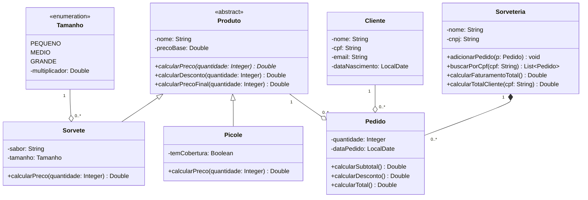

# 🍦 Sorveteria

Sistema de gerenciamento de uma sorveteria feito em **Java**, com interface de linha de comando (menu no terminal) e persistência em **MySQL** via **JDBC**. Projeto acadêmico de tema livre, com foco em orientação a objetos (herança, polimorfismo, encapsulamento) e acesso a banco de dados.

Com ele é possível cadastrar sorvetes, picolés e clientes, registrar pedidos (com desconto automático por quantidade) e consultar o faturamento da sorveteria.

## Tecnologias

- Java 21
- Maven
- MySQL 8
- JDBC (`mysql-connector-j` 8.4.0)

## Diagrama de classes

O diagrama editável no draw.io está em [`docs/diagrama-de-classes.drawio`](docs/diagrama_sorveteria.drawio). Abaixo, a mesma estrutura em Mermaid:



## Classes e regras de negócio

| Classe | Papel |
|---|---|
| `Produto` | Classe abstrata com `nome` e `precoBase`. Define o método abstrato `calcularPreco()` e os métodos `calcularDesconto()` e `calcularPrecoFinal()`. |
| `Sorvete` | Herda de `Produto`. Tem `sabor` e `tamanho`. |
| `Picole` | Herda de `Produto`. Tem `temCobertura`. |
| `Tamanho` | Enum (`PEQUENO`, `MEDIO`, `GRANDE`), cada valor com um multiplicador de preço. |
| `Cliente` | Dados do cliente: nome, CPF, e-mail e data de nascimento. |
| `Pedido` | Liga um cliente a um produto, com quantidade e data. Calcula subtotal, desconto e total. |
| `Sorveteria` | Agrupa os pedidos e calcula o faturamento total e o total gasto por cliente. Não tem tabela própria no banco. |

**Polimorfismo:** cada subclasse calcula o preço do seu jeito.

| Produto | Cálculo do preço |
|---|---|
| Sorvete | `precoBase × multiplicador do tamanho × quantidade` (Pequeno 1.0, Médio 1.5, Grande 2.0) |
| Picolé | `(precoBase + R$ 2,00 se tiver cobertura) × quantidade` |

**Desconto:** a partir de 5 unidades no mesmo pedido, 10% de desconto sobre o subtotal.

Exemplo: 5 sorvetes grandes com preço base de R$ 10,00 → subtotal R$ 100,00, desconto R$ 10,00, total R$ 90,00.

## Banco de dados

A herança é representada com **uma tabela por classe**: `sorvete` e `picole` guardam só os atributos extras e usam o mesmo `id` de `produto` como chave primária e estrangeira.

| Tabela | Colunas principais |
|---|---|
| `produto` | `id`, `nome`, `preco_base` |
| `sorvete` | `id_produto` (PK/FK), `sabor`, `tamanho` |
| `picole` | `id_produto` (PK/FK), `tem_cobertura` |
| `cliente` | `id`, `nome`, `cpf` (único), `email`, `data_nascimento` |
| `pedido` | `id`, `id_cliente` (FK), `id_produto` (FK), `quantidade`, `data_pedido` |

O script completo está em [`sql/script.sql`](sql/script.sql).

## Como executar

1. Tenha instalados o **JDK 21+** e o **MySQL 8**.
2. Crie o banco e as tabelas executando o `sql/script.sql` (pelo MySQL Workbench ou pelo terminal):
   ```bash
   mysql -u root -p < sql/script.sql
   ```
3. Em `src/main/java/sorveteria/db/Conexao.java`, ajuste a URL, o usuário e a senha do seu MySQL. Não publique a sua senha real no repositório.
4. Abra o projeto em uma IDE (IntelliJ, Eclipse, VS Code), deixe o Maven baixar as dependências e execute a classe `sorveteria.Main`.

## Menu do sistema

```
1  - Cadastrar sorvete
2  - Cadastrar picolé
3  - Listar produtos
4  - Buscar produto por nome
5  - Cadastrar cliente
6  - Listar clientes
7  - Registrar pedido
8  - Listar pedidos
9  - Buscar pedidos por CPF
10 - Faturamento total da sorveteria
11 - Total gasto por cliente (CPF)
0  - Sair
```

Para registrar um pedido, o produto e o cliente (identificado pelo CPF) precisam estar cadastrados antes.

## Estrutura do projeto

```
sorveteria/
├── docs/
│   └── diagrama-de-classes.drawio
├── sql/
│   └── script.sql
├── src/main/java/sorveteria/
│   ├── Main.java              # menu e leitura do teclado
│   ├── db/
│   │   └── Conexao.java       # conexão JDBC com o MySQL
│   ├── model/                 # Produto, Sorvete, Picole, Tamanho,
│   │                          # Cliente, Pedido, Sorveteria
│   └── dao/                   # ProdutoDAO, ClienteDAO, PedidoDAO
└── pom.xml
```

## Autor

Matheus Gonçalves — Sistemas de Informação, São Paulo Tech School.
